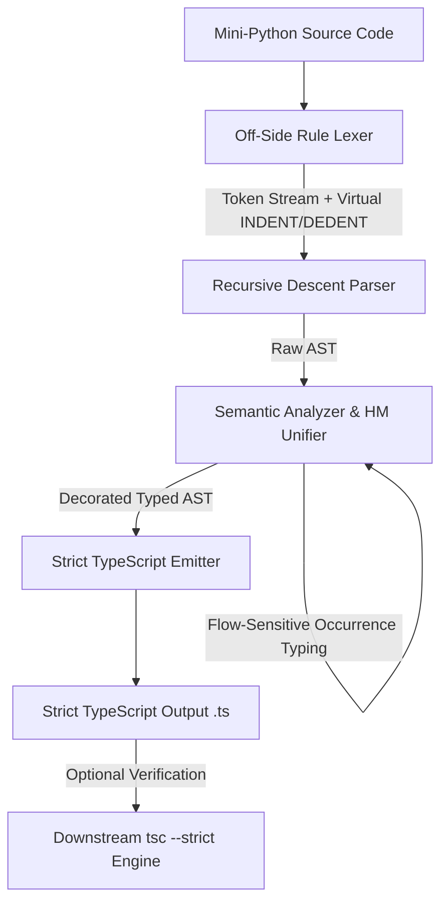

# Mini-Python to Strict TypeScript Transpiler

[]()
[]()
[]()
[]()
[]()

> A high-assurance, multi-stage compiler translating dynamically typed Mini-Python programs into strictly typed, production-ready TypeScript (ES2022/ESNext) with bidirectional Hindley-Milner type inference and flow-sensitive occurrence typing.

---

## Table of Contents

- [Overview](#overview)
- [Key Features](#key-features)
- [Compiler Architecture](#compiler-architecture)
- [Language Support & Mapping](#language-support--mapping)
- [Installation](#installation)
- [Quick Start](#quick-start)
  - [Command-Line Interface (CLI)](#command-line-interface-cli)
  - [Programmatic API](#programmatic-api)
  - [Interactive Workbench & AST Visualizer](#interactive-workbench--ast-visualizer)
- [Verification & Testing](#verification--testing)
- [Contributing](#contributing)
- [License](#license)

---

## Overview

The **Mini-Python to Strict TypeScript Transpiler** provides an end-to-end translation pipeline designed to eliminate dynamic typing ambiguities before code emission. Rather than generating loose JavaScript with permissive `any` types, the transpiler performs rigorous static analysis to infer precise types across variables, parameters, return paths, and collection literals.

By executing **bidirectional constraint propagation (Algorithm W unification)** alongside **flow-sensitive occurrence typing**, the compiler statically resolves structural types, handles union narrowing on runtime type guards (e.g., `isinstance()` and `is None`), and generates idiomatic TypeScript that compiles cleanly under `tsc --strict` without requiring runtime shims or external helper packages.

---

## Key Features

- **Off-Side Rule Lexical Analyzer**: Tracks Python-style indentation using an internal indentation stack, synthesizing virtual `INDENT` and `DEDENT` tokens with accurate source coordinate mappings.
- **LL(k) Recursive Descent Parser**: Converts token streams into an immutable, strongly-typed Abstract Syntax Tree (AST) with operator precedence and deep diagnostic error reporting.
- **Hindley-Milner Type Inference (Algorithm W)**: Infers types bidirectionally from call sites, assignments, arithmetic operators, and return statements with occurs-check protection to eliminate circular recursive types.
- **Flow-Sensitive Occurrence Typing**: Dynamically narrows union types within `if`/`while` blocks upon evaluating guard expressions (`isinstance(x, int)`, `is None`, `is not None`) and propagates narrowed types into scope branches.
- **Idiomatic TypeScript Code Emitter**:
  - Emits clean, human-readable TypeScript adhering to strict formatting and scoping conventions.
  - Maps Python slicing semantics (`arr[start:stop:step]`, negative indices) into clean inline ES slice operations.
  - Transpiles single-loop and multi-loop list comprehensions directly into functional `.map()`, `.filter()`, and `.flatMap()` chains.
  - Supports `--module` flag for generating clean ES module export declarations.
- **Automated Verification Pipeline**: Integrated end-to-end compiler verification harness invoking the official `tsc` compiler programmatically to ensure 0 type errors on emitted output.
- **Built-in Visualizer Workbench**: Zero-dependency embedded HTTP server providing real-time AST node-link tree visualizers, interactive symbol table inspectors, and token stream explorers.

---

## Compiler Architecture

The compilation pipeline operates as a sequence of deterministic stages:



### Pipeline Stages

1. **Lexical Analysis (`src/lexer/`)**:
   - Tokenizes literals, keywords, identifiers, and compound operators.
   - Manages off-side indentation levels using an explicit column stack, generating balance-verified `INDENT` and `DEDENT` tokens.
   - Preserves source location spans (`line`, `column`, `offset`) on every token for precise diagnostics.
2. **Syntactic Analysis (`src/parser/`)**:
   - Implements predictive LL(k) recursive descent parsing.
   - Constructs typed AST nodes for statements (`VariableDeclaration`, `FunctionDeclaration`, `IfStatement`, `WhileStatement`, `ReturnStatement`) and expressions (`BinaryExpression`, `CallExpression`, `IndexExpression`, `SliceExpression`, `ListComprehension`).
3. **Semantic Analysis & Type Inference (`src/semantics/`)**:
   - Builds hierarchical lexical scopes (`Scope`) linked to parent lexical environments.
   - Generates and solves type equality constraints using first-order unification with substitution tracking.
   - Narrows types across branches through branch-sensitive condition analysis (`unionSubtract`).
4. **Code Generation (`src/codegen/`)**:
   - Traverses decorated AST nodes to emit strict TypeScript syntax.
   - Generates explicit type annotations for parameter lists, return types, and local variable declarations.
   - Desugars Python constructs (e.g., list comprehensions, slices) into idiomatic TypeScript equivalents.

---

## Language Support & Mapping

| Python Construct | Transpiled TypeScript Construct | Type Inferred |
| :--- | :--- | :--- |
| `x = 42` | `let x: number = 42;` | `number` |
| `name = "transpiler"` | `let name: string = "transpiler";` | `string` |
| `def add(a, b): return a + b` | `function add(a: number, b: number): number { ... }` | `(number, number) => number` |
| `items = [1, 2, 3]` | `let items: number[] = [1, 2, 3];` | `number[]` |
| `items[:2]` | `items.slice(0, 2);` | `number[]` |
| `items[-1]` | `items.at(-1);` | `number` |
| `[x * 2 for x in data if x > 0]` | `data.filter((x: number) => x > 0).map((x: number) => x * 2);` | `number[]` |
| `if isinstance(val, int): ...` | `if (typeof val === "number") { ... }` | Narrowed to `number` in block |
| `if val is None: ...` | `if (val === null) { ... }` | Narrowed to `null` in block |

---

## Installation

### Prerequisites

- **Node.js**: `>= 18.0.0`
- **npm**: `>= 9.0.0`

### Setup

```bash
# Clone the repository
git clone https://github.com/TEA-21/Transpiler.git
cd Transpiler

# Install dependencies
npm install

# Build TypeScript distribution
npm run build
```

---

## Quick Start

### Command-Line Interface (CLI)

The CLI tool `mini-python-transpile` supports file-based processing, standard input streaming, type checking, and automated `tsc` verification.

```bash
# Transpile a file and print to standard output
npx tsx src/cli.ts input.py

# Transpile and write output to a file
npx tsx src/cli.ts input.py -o output.ts

# Type-check without emitting code
npx tsx src/cli.ts input.py --check

# Dump decorated AST as formatted JSON
npx tsx src/cli.ts input.py --emit-ast

# Transpile with ES module export declarations
npx tsx src/cli.ts input.py --module -o output.ts

# Transpile and verify zero type errors with downstream tsc --strict
npx tsx src/cli.ts input.py --verify-tsc
```

#### CLI Options Reference

| Flag | Description |
| :--- | :--- |
| `-o, --output <file>` | Writes emitted TypeScript to the specified destination path. |
| `--check, --check-types` | Executes lexical, syntactic, and semantic type checking without code emission. |
| `--emit-ast` | Outputs the fully decorated Abstract Syntax Tree as JSON. |
| `--module` | Generates module export declarations for top-level definitions. |
| `--verify-tsc` | Compiles emitted TypeScript with `tsc --strict` to guarantee type soundness. |
| `-v, --version` | Displays transpiler version information. |
| `-h, --help` | Displays command line usage instructions. |

---

### Programmatic API

The compiler exports high-level orchestration methods as well as individual pipeline stages:

```typescript
import { 
  transpileMiniPython, 
  analyzeMiniPython, 
  parseMiniPython 
} from 'mini-python-transpiler';

const pythonCode = `
def compute_scores(raw_data):
    filtered = [x * 10 for x in raw_data if isinstance(x, int)]
    return filtered

scores = compute_scores([5, "invalid", 12])
`;

// 1. Full Transpilation Pipeline
const { tsCode, rootScope } = transpileMiniPython(pythonCode, { moduleMode: true });
console.log(tsCode);

// 2. Semantic Analysis Only
const { rootScope: scope, program: ast } = analyzeMiniPython(pythonCode);
const symbolCount = scope.getAllSymbols().size;
console.log(`Resolved ${symbolCount} scoped symbols.`);

// 3. Parser AST Only
const rawAst = parseMiniPython(pythonCode);
console.log(JSON.stringify(rawAst, null, 2));
```

#### Emitted TypeScript Output

```typescript
export function compute_scores(raw_data: (number | string)[]): number[] {
  let filtered: number[] = raw_data
    .filter((x: number | string): x is number => typeof x === "number")
    .map((x: number) => x * 10);
  return filtered;
}

export let scores: number[] = compute_scores([5, "invalid", 12]);
```

---

### Interactive Workbench & AST Visualizer

An interactive developer visualizer is included in the repository. It runs an embedded HTTP server with zero third-party web framework dependencies.

```bash
npm run ui
```

Navigate to `http://localhost:3000` to access:
- **Split-Pane Editor**: Live Mini-Python to Strict TypeScript transpilation with instant feedback.
- **2D AST Tree Diagram**: Interactive node-link AST visualizer with hierarchical tidy layout, pan, and zoom.
- **Scoped Symbol Table Inspector**: Tree view displaying lexical scopes, identifier bindings, and unified static types.
- **Lexer Token Stream**: Color-coded breakdown of tokens with synthetic indentation markers.

---

## Verification & Testing

The project maintains a comprehensive test suite executed through [Vitest](https://vitest.dev/):

```bash
# Run test suite
npm test

# Run tests in watch mode
npm run test:watch
```

### Test Coverage Highlights

- **Lexer Tests (`tests/lexer.test.ts`)**: Validates off-side indentation, dedent stacking, comment stripping, and token coordinates.
- **Parser Tests (`tests/parser.test.ts`)**: Asserts operator precedence, nested blocks, loop structures, and AST node integrity.
- **Semantics Tests (`tests/semantics.test.ts`)**: Tests Algorithm W unification, parameter inference, union types, and type error diagnostics.
- **Emitter Tests (`tests/emitter.test.ts`)**: Verifies slicing translation, list comprehension functional chains, and module exports.
- **End-to-End Compiler Tests (`tests/e2e_tsc.test.ts`)**: Automatically feeds transpiled code to the official TypeScript compiler (`tsc --strict`) ensuring zero compilation warnings or type errors.

---

## Contributing

Contributions to expand language coverage, optimize constraint solving, or improve diagnostics are welcome.

1. **Fork the repository** on GitHub.
2. **Create a feature branch**:
   ```bash
   git checkout -b feat/comprehension-generator-expressions
   ```
3. **Commit your modifications** using [Conventional Commits](https://www.conventionalcommits.org/):
   ```bash
   git commit -m "feat: Add support for generator expressions in comprehensions"
   ```
4. **Ensure all verification checks pass**:
   ```bash
   npm test
   npm run build
   ```
5. **Open a Pull Request** with a concise description of your changes and added test cases.

---

## License

This project is licensed under the [ISC License](LICENSE).
